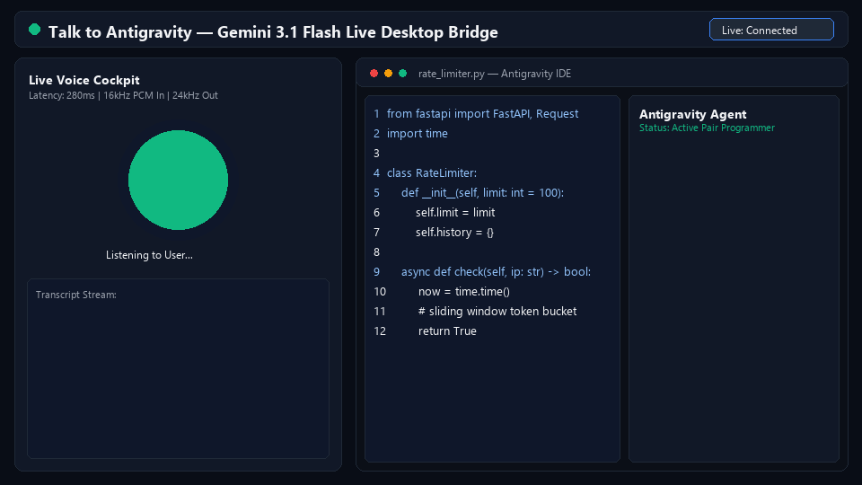

# VocalDesk

> **Realtime Voice, Vision & Command Bridge for Google Antigravity & Windows 11**  
> *„Einsetzbar überall, wo du keine Lust hast zu tippen.“*

[](LICENSE)
[](https://python.org)
[](https://ai.google.dev)
[](https://microsoft.com/windows)

---

> [!IMPORTANT]
> **Legal Disclaimer & Trademark Notice:**  
> **VocalDesk** is an independent open-source project and is **not affiliated with, sponsored by, or endorsed by Google LLC**.  
> *Google, Gemini, and Antigravity are trademarks of Google LLC.*

---

<p align="center">
  
</p>

**VocalDesk** is a bidirectional real-time voice, desktop vision, and command bridge connecting the Google Gemini Multimodal Live API (`gemini-3.1-flash-live-preview`) directly to the **Google Antigravity IDE** on Windows 11.

It acts as an interactive hands-free co-pilot: Discuss architecture ideas, share your monitor in real time, and dispatch prompts or dictations straight into your active Antigravity IDE coding session without touching your keyboard.

---

## Architecture Overview

```
                      +----------------------------------------+
                      |               User (Voice)             |
                      +----------------------------------------+
                                      ^        |
                              24 kHz  |        | 16 kHz PCM
                              Speaker |        | Microphone
                                      |        v
               +------------------------------------------------------+
               |             VocalDesk (Local Web UI)                 |
               |             http://127.0.0.1:8765                    |
               +------------------------------------------------------+
                         ^                                    |
          HTTP /api/tars |                                    | WebSocket
          Reverse Audio  |                                    | (Audio, Video,
                         |                                    |  JSON Control)
                         v                                    v
     +-------------------------------+         +-------------------------------+
     |      Antigravity MCP Server   |         |    Google Gemini Live API     |
     |           (server.py)         |         | (gemini-3.1-flash-live-prev)  |
     +-------------------------------+         +-------------------------------+
                         ^                                    |
                         | Win32 Focus & Paste Injection      | Tool Call:
                         | (Set-Clipboard + Ctrl+V + Enter)   | send_to_antigravity(prompt)
                         +------------------------------------+
                                      |
                                      v
                      +--------------------------------+
                      |     Antigravity IDE Window     |
                      |        (Antigravity.exe)       |
                      +--------------------------------+
```

---

## Key Features

1. **Continuous Multi-Turn Voice Streaming:**
   - Full-duplex WebSocket connection via official `google-genai` SDK.
   - Native 16 kHz audio capture and 24 kHz speech synthesis with zero-lag response.
   - Real-time barge-in: Interrupt speech playback mid-sentence naturally.

2. **Smart Inactivity Window (Silence Protection):**
   - Does not disconnect during thinking pauses.
   - Configurable timeout: 60s, 120s (default), 300s, or unlimited.

3. **Live Desktop Screen Sharing:**
   - One-click screen sharing (`getDisplayMedia`) streaming scaled 1024px JPEG frames directly to Gemini Live every 1.5 seconds.
   - The assistant inspects code diffs, UI layouts, and terminal errors live.

4. **Direct Win32 Window Injection:**
   - Automatically invokes `send_to_antigravity(prompt)` on triggers like *"Gib das an Antigravity weiter"* or *"Tippe das für mich ein"*.
   - Uses native Win32 API calls (`SetForegroundWindow` with `ALT` lock bypass, clipboard injection, `Enter`).
   - Supports **Intermediary Mode** (smart relay) and **Direct Dictation Mode** (transcribes directly to target window).

5. **Reverse Audio Bridge:**
   - Antigravity's MCP `speak` tool pushes completed agent answers back into the active session via `POST /api/tars/announce`.
   - The assistant reads Antigravity's answers aloud through your speakers.

---

## Editions

| Feature | Community Edition (Open Source) | Pro Edition (Precompiled Standalone) |
| :--- | :---: | :---: |
| **Full Source Code** | Yes (MIT) | Precompiled Standalone `.exe` |
| **Python / Environment Setup** | Required | **None (Zero-Install)** |
| **Windows System-Tray Integration** | Manual script | **Included** |
| **Auto-Start & Background Updates** | No | **Included** |
| **Pricing** | Free (Bring Your Own Key) | Commercial License |

---

## Quick Start (Community Edition)

### Prerequisites
* Windows 10 or Windows 11
* Python 3.10 or newer
* Google AI Studio API Key ([aistudio.google.com](https://aistudio.google.com))

### 1. Installation
```powershell
git clone https://github.com/dersimlicagri-byte/talk-to-antigravity.git vocaldesk
cd vocaldesk
powershell -ExecutionPolicy Bypass -File .\install.ps1
```

### 2. Configure MCP in Antigravity
Add the server to your `~/.gemini/config/mcp_config.json`:
```json
{
  "mcpServers": {
    "vocaldesk": {
      "command": "C:\\path\\to\\vocaldesk\\.venv\\Scripts\\python.exe",
      "args": [
        "C:\\path\\to\\vocaldesk\\server.py"
      ],
      "env": {
        "GEMINI_API_KEY": "YOUR_AI_STUDIO_API_KEY"
      }
    }
  }
}
```

### 3. Launch
```powershell
.\start_tars.bat
```
Open [http://127.0.0.1:8765](http://127.0.0.1:8765) in any modern browser.

---

## License & Copyright

- **Community Edition:** Licensed under the [MIT License](LICENSE).
- **Trademark Notice:** *Antigravity, Gemini, and Google are trademarks of Google LLC.* VocalDesk is an independent project.
